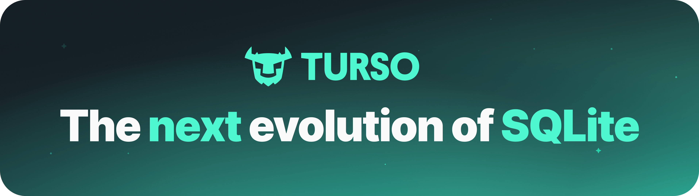
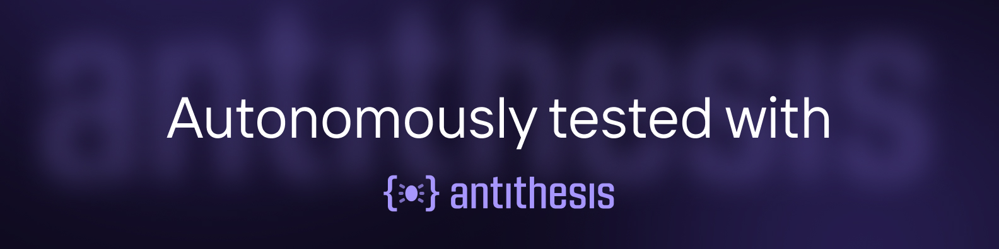
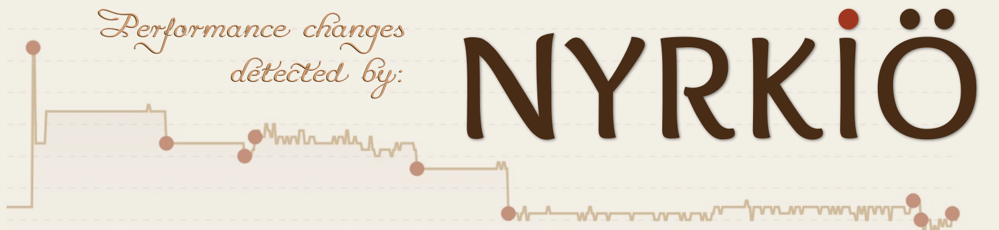

<p align="center">
  
  <h1 align="center">Turso Database</h1>
</p>

<p align="center">
  Prosessin sisäinen SQL-tietokanta, joka on yhteensopiva SQLiten kanssa ja jossa on nyt myös Postgres-käyttöliittymä.
</p>
<p align="center"><a href="./README.md">English</a> | <a href="./README.zh-CN.md">简体中文</a> | <b>Suomi</b></p>

<p align="center">
  <a title="Käännöksen tila" target="_blank" href="https://github.com/tursodatabase/turso/actions/workflows/rust.yml"></a>
  <a title="Julkaisut" target="_blank" href="https://github.com/tursodatabase/turso/releases"></a>
  <a title="Rust" target="_blank" href="https://crates.io/crates/turso"></a>
  <a title="JavaScript" target="_blank" href="https://www.npmjs.com/package/@tursodatabase/database"></a>
  <a title="Python" target="_blank" href="https://pypi.org/project/pyturso/"></a>
  <a title="Java" target="_blank" href="https://central.sonatype.com/artifact/tech.turso/turso"></a>
  <a title=".NET" target="_blank" href="https://www.nuget.org/packages/Turso.Data.Sqlite.Provider"></a>
  <a title="MIT" target="_blank" href="https://github.com/tursodatabase/turso/blob/main/LICENSE.md"></a>
  <br>
  <a title="GitHub Pull Requests" target="_blank" href="https://github.com/tursodatabase/turso/pulls"></a>
  <a title="GitHub-commitit" target="_blank" href="https://github.com/tursodatabase/turso/commits/main"></a>
  <a title="Viimeisin commit" target="_blank" href="https://github.com/tursodatabase/turso/commits/main"></a>
</p>
<p align="center">
  <a title="Kehittäjien Discord" target="_blank" href="https://discord.gg/jgjmyYgHwB"></a>
</p>
<p align="center">
  <a title="Käyttäjien Discord" target="_blank" href="https://tur.so/discord"></a>
</p>

---

## Tietoja

Turso on Rustilla kirjoitettu, prosessin sisäinen SQL-tietokanta, joka on yhteensopiva SQLiten kanssa. Se on jo tuotantokäytössä useissa organisaatioissa.

Turso on myös virtuaalikone. SQLiten tapaan se kääntää SQL:n tämän koneen, VDBE:n, tavukoodiksi ja suorittaa sen. Tämän rakenteen ansiosta yksi moottori voi tukea useampaa kuin yhtä SQL-murretta. SQLite on ensimmäinen ja tärkein käyttöliittymä, joka kääntää tälle koneelle, ja Postgresilla on nyt oma käyttöliittymänsä omine murteineen ja verkkoprotokollineen. Lisää on tulossa. Tavoitteemme on olla tietokannoille sitä, mitä LLVM on kääntäjille: yksi moderni ja luotettava ydin, jolle monta käyttöliittymää kääntää.

Kuinka yleiskäyttöinen tämä ydin on? Niin yleiskäyttöinen, että sillä voi [pelata Doomia](https://github.com/tursodatabase/turso-vdbe-doom-example).

[Usein kysytyistä kysymyksistä](#usein-kysytyt-kysymykset) näet, missä vaiheessa projekti on matkalla kohti versiota 1.0.

## Ominaisuudet ja tiekartta

* **SQLite-yhteensopivuus** SQL-murteen, tiedostomuotojen ja C-rajapinnan osalta, seuraten SQLiten versiota 3.50.4 [katso lisätiedot [dokumentista](COMPAT.md)]
* **`BEGIN CONCURRENT`** parantaa kirjoitusten läpäisykykyä moniversioisen samanaikaisuudenhallinnan (MVCC) avulla.
* **Muutostietojen sieppaus (CDC)** tietokannan muutosten seuraamiseen reaaliajassa.
* **Tuki monille ohjelmointikielille**:
  * [Go](bindings/go)
  * [JavaScript](bindings/javascript)
  * [Java](bindings/java)
  * [.NET](bindings/dotnet)
  * [Python](bindings/python)
  * [Rust](bindings/rust)
  * [WebAssembly](bindings/javascript)
* **Asynkroninen I/O** Linuxilla `io_uring`-rajapinnan avulla
* **Monialustaisuus**: tuki Linuxille, macOS:lle, Windowsille ja selaimille (WebAssemblyn kautta)
* **Vektorituki**, mukaan lukien tarkka haku ja vektorien käsittely
* **Parempi skeemanhallinta**, mukaan lukien laajennettu `ALTER`-tuki ja nopeammat skeemamuutokset.

Tietokannassa on seuraavat kokeelliset ominaisuudet:

* **Postgres-yhteensopivuus** SQL-murteen ja verkkoprotokollan osalta, katso lisätiedot [yhteensopivuusdokumentista](postgres/COMPAT.md).
* **Tallennettavan datan salaus** tietojen suojaamiseen paikallisesti.
* **Inkrementaalinen laskenta** DBSP:n avulla näkymien inkrementaaliseen ylläpitoon ja kyselytilauksiin.
* **Kokotekstihaku**, jonka taustalla on mainio [tantivy](https://github.com/quickwit-oss/tantivy)-kirjasto
* **WAL-koordinointi usean prosessin välillä** `.tshm`-sivutiedoston avulla, jotta eri prosessit voivat lukea ja kirjoittaa samaa WAL-lokia.

Nykyisellä tiekartallamme on seuraavat ominaisuudet:

* **Vektori-indeksointi** nopeaan likimääräiseen vektorihakuun, samaan tapaan kuin [libSQL:n vektorihaku](https://turso.tech/vector).

## Aloittaminen

Lisätietoja löydät [Turso-tietokannan käsikirjasta](docs/manual.md).

<details>
<summary>💻 Komentorivi</summary>
<br>
Voit asentaa uusimman `turso`-julkaisun komennolla:

```shell
curl --proto '=https' --tlsv1.2 -LsSf \
  https://github.com/tursodatabase/turso/releases/latest/download/turso_cli-installer.sh | sh
```

Käynnistä sitten interaktiivinen komentotulkki:

```shell
$ tursodb
```

Tämä käynnistää Turson interaktiivisen komentotulkin, jossa voit suorittaa SQL-lauseita:

```console
Turso
Enter ".help" for usage hints.
Connected to a transient in-memory database.
Use ".open FILENAME" to reopen on a persistent database
turso> CREATE TABLE users (id INT, username TEXT);
turso> INSERT INTO users VALUES (1, 'alice');
turso> INSERT INTO users VALUES (2, 'bob');
turso> SELECT * FROM users;
1|alice
2|bob
```

Voit myös kääntää ja ajaa uusimman kehitysversion komennolla:

```shell
cargo run
```

Jos pidät Dockerista, sekin onnistuu. Aja vain tämä projektin juurihakemistossa:

```bash
make docker-cli-build && \
make docker-cli-run
```

</details>

<details>
<summary>🦀 Rust</summary>
<br>

```console
cargo add turso
```

Käyttöesimerkki:

```rust
let db = Builder::new_local("sqlite.db").build().await?;
let conn = db.connect()?;

let res = conn.query("SELECT * FROM users", ()).await?;
```
</details>

<details>
<summary>✨ JavaScript</summary>
<br>

```console
npm i @tursodatabase/database
```

Käyttöesimerkki:

```js
import { connect } from '@tursodatabase/database';

const db = await connect('sqlite.db');
const stmt = db.prepare('SELECT * FROM users');
const users = stmt.all();
console.log(users);
```
</details>

<details>
<summary>🐍 Python</summary>
<br>

```console
uv pip install pyturso
```

Käyttöesimerkki:

```python
import turso

con = turso.connect("sqlite.db")
cur = con.cursor()
res = cur.execute("SELECT * FROM users")
print(res.fetchone())
```
</details>

<details>
<summary>🦫 Go</summary>
<br>

```console
go get turso.tech/database/tursogo
go install turso.tech/database/tursogo
```

Käyttöesimerkki:
```go
import (
    "database/sql"
    _ "turso.tech/database/tursogo"
)

conn, _ = sql.Open("turso", "sqlite.db")
defer conn.Close()

stmt, _ := conn.Prepare("select * from users")
defer stmt.Close()

rows, _ = stmt.Query()
for rows.Next() {
    var id int
    var username string
    rows.Scan(&id, &username)
    fmt.Printf("User: ID: %d, Username: %s\n", id, username)
}
```
</details>


<details>

<summary>️#️⃣ .NET</summary>
<br>

Käyttöesimerkki:
```cs
using Turso;

using var connection = new TursoConnection("Data Source=:memory:");
connection.Open();

connection.ExecuteNonQuery("CREATE TABLE t(a, b)");
var rowsAffected = connection.ExecuteNonQuery("INSERT INTO t(a, b) VALUES (1, 2), (3, 4)");
Console.WriteLine($"RowsAffected: {rowsAffected}");

using var command = connection.CreateCommand();
command.CommandText = "SELECT * FROM t";
using var reader = command.ExecuteReader();
while (reader.Read())
{
    var a = reader.GetInt32(0);
    var b = reader.GetInt32(1);
    Console.WriteLine($"Value1: {a}, Value2: {b}");
}
```
</details>


<details>

<summary>☕️ Java</summary>
<br>

Olemme integroineet Turso-tietokannan JDBC:hen. Tarkemmat ohjeet Turso-tietokannan käyttämiseen Javalla löydät
[bindings/java-hakemiston README.md-tiedostosta](bindings/java/README.md).
</details>

<details>
<summary>🤖 MCP-palvelintila</summary>
<br>


Turson komentorivityökalussa on sisäänrakennettu [Model Context Protocol (MCP)](https://modelcontextprotocol.io/) -palvelin, jonka avulla tekoälyavustajat voivat käyttää tietokantojasi.

Käynnistä MCP-palvelin komennolla:

```shell
tursodb your_database.db --mcp
```

### Määritykset

Lisää Turso MCP-asiakasohjelmasi määrityksiin:

```json
{
  "mcpServers": {
    "turso": {
      "command": "/path/to/.turso/tursodb",
      "args": ["/path/to/your/database.db", "--mcp"]
    }
  }
}
```

### Käytettävissä olevat työkalut

MCP-palvelin tarjoaa yhdeksän työkalua tietokannan käyttämiseen:

1. **`open_database`** - Avaa uusi tietokanta
2. **`current_database`** - Kuvaile nykyinen tietokanta
3. **`list_tables`** - Listaa tietokannan kaikki taulut
4. **`describe_table`** - Kuvaile tietyn taulun rakenne
5. **`execute_query`** - Suorita vain luku -tyyppisiä SELECT-kyselyitä
6. **`insert_data`** - Lisää uutta dataa tauluihin
7. **`update_data`** - Päivitä taulujen olemassa olevaa dataa
8. **`delete_data`** - Poista dataa tauluista
9. **`schema_change`** - Suorita skeemaa muuttavia lauseita (CREATE TABLE, ALTER TABLE, DROP TABLE)

Kun yhteys on muodostettu, voit pyytää tekoälyavustajaltasi esimerkiksi:

- "Näytä kaikki tietokannan taulut"
- "Mikä on users-taulun skeema?"
- "Etsi kaikki julkaisut, joilla on yli 100 ääntä"
- "Lisää uusi käyttäjä, jonka nimi on 'Alice' ja sähköposti 'alice@example.com'"

### MCP-asiakasohjelmat

<details>
<summary>Claude Code</summary>

Jos käytät [Claude Codea](https://claude.ai/code), voit yhdistää Turson MCP-palvelimeen helposti sisäänrakennetuilla MCP-hallintakomennoilla:

#### Pika-asennus

1. **Lisää MCP-palvelin** Claude Codeen:

   ```bash
   claude mcp add my-database -- tursodb ./path/to/your/database.db --mcp
   ```

2. **Käynnistä Claude Code uudelleen**, jotta yhteys otetaan käyttöön

3. **Aloita kyselyt** tietokantaasi luonnollisella kielellä!

#### Komennon osat

```bash
claude mcp add my-database -- tursodb ./path/to/your/database.db --mcp
#              ↑            ↑       ↑                           ↑
#              |            |       |                           |
#              Name         |       Database path               MCP flag
#                          Separator
```

- **`my-database`** - Valitse MCP-palvelimellesi mikä tahansa nimi
- **`--`** - Pakollinen erotin Clauden valitsimien ja oman komentosi välillä
- **`tursodb`** - Turso-tietokannan komentorivityökalu
- **`./path/to/your/database.db`** - Polku SQLite-tietokantatiedostoosi
- **`--mcp`** - Ottaa MCP-palvelintilan käyttöön

#### Käyttöesimerkkejä

```bash
# For a local project database
cd /your/project
claude mcp add my-project-db -- tursodb ./data/app.db --mcp

# For an absolute path
claude mcp add analytics-db -- tursodb /Users/you/databases/analytics.db --mcp

# For a specific project (local scope)
claude mcp add project-db --local -- tursodb ./database.db --mcp
```

#### MCP-palvelinten hallinta

```bash
# List all configured MCP servers
claude mcp list

# Get details about a specific server
claude mcp get my-database

# Remove an MCP server
claude mcp remove my-database
```

</details>

<details>
<summary>Claude Desktop</summary>

Claude Desktopissa lisää määritys `claude_desktop_config.json`-tiedostoon:

```json
{
  "mcpServers": {
    "turso": {
      "command": "/path/to/.turso/tursodb",
      "args": ["./path/to/your/database.db", "--mcp"]
    }
  }
}
```

</details>

<details>
<summary>Cursor</summary>

Cursorissa määritä MCP asetuksista:

1. Avaa Cursorin asetukset
2. Siirry kohtaan Extensions → MCP
3. Lisää uusi palvelin seuraavilla tiedoilla:
   - **Name**: `turso`
   - **Command**: `/path/to/.turso/tursodb`
   - **Args**: `["./path/to/your/database.db", "--mcp"]`

Vaihtoehtoisesti voit lisätä sen suoraan Cursorin määritystiedostoon.

</details>

### JSON-RPC:n käyttö suoraan

MCP-palvelin toimii yhtenä prosessina, joka käsittelee useita JSON-RPC-pyyntöjä vakiosyötteen ja vakiotulosteen (stdin/stdout) kautta. Näin voit käyttää sitä suoraan:

#### Esimerkki muistissa olevalla tietokannalla

```bash
cat << 'EOF' | tursodb --mcp
{"jsonrpc": "2.0", "id": 1, "method": "initialize", "params": {"protocolVersion": "2024-11-05", "capabilities": {}, "clientInfo": {"name": "client", "version": "1.0"}}}
{"jsonrpc": "2.0", "id": 2, "method": "tools/call", "params": {"name": "schema_change", "arguments": {"query": "CREATE TABLE users (id INTEGER, name TEXT, email TEXT)"}}}
{"jsonrpc": "2.0", "id": 3, "method": "tools/call", "params": {"name": "list_tables", "arguments": {}}}
{"jsonrpc": "2.0", "id": 4, "method": "tools/call", "params": {"name": "insert_data", "arguments": {"query": "INSERT INTO users VALUES (1, 'Alice', 'alice@example.com')"}}}
{"jsonrpc": "2.0", "id": 5, "method": "tools/call", "params": {"name": "execute_query", "arguments": {"query": "SELECT * FROM users"}}}
EOF
```

#### Esimerkki olemassa olevalla tietokannalla

```bash
# Working with an existing database file
cat << 'EOF' | tursodb mydb.db --mcp
{"jsonrpc": "2.0", "id": 1, "method": "initialize", "params": {"protocolVersion": "2024-11-05", "capabilities": {}, "clientInfo": {"name": "client", "version": "1.0"}}}
{"jsonrpc": "2.0", "id": 2, "method": "tools/call", "params": {"name": "list_tables", "arguments": {}}}
EOF
```

</details>

## Osallistuminen

Olisimme iloisia, jos osallistuisit Turso-tietokannan kehittämiseen! Pääset alkuun [osallistumisohjeiden][contribution guide] avulla.

## Usein kysytyt kysymykset

### Onko Turso-tietokanta valmis tuotantokäyttöön?

Kyllä. Turso on jo tuotantokäytössä useissa organisaatioissa, kuten [Turso Cloudissa](https://turso.tech/signup), [Kin-tekoälyavustajassa](https://mykin.ai/) ja [Spice.ai:ssa](https://github.com/spiceai/spiceai). Luotettavuus on tärkein prioriteettimme: Tursoa testataan perusteellisesti useilla työkaluilla, kuten omalla deterministisellä simulaatiotestauksella (Deterministic Simulation Testing) ja [Antithesisillä](https://antithesis.com).

Versiota 1.0 ei kuitenkaan ole vielä julkaistu. Projektia kehitetään aktiivisesti, ja osa ominaisuuksista on erikseen merkitty kokeellisiksi. Tavoitteenamme on SQLiten tasoinen luotettavuus, ja SQLite on yksi maailman perusteellisimmin testatuista ohjelmistoista. Kunnes julkaisemme version 1.0, suosittelemme samaa huolellisuutta kuin minkä tahansa tietokannan kanssa: pidä erilliset varmuuskopiot.

### Kuinka yhteensopiva Turso-tietokanta on SQLiten kanssa?

Turso on yhteensopiva SQLiten kanssa SQL-murteen, tiedostomuodon ja C-rajapinnan tasolla, ja olemassa olevat SQLite-tietokantatiedostot toimivat sellaisenaan. Täyttä 100 %:n yhteensopivuutta ei vielä ole, joten joitakin eroja on edelleen odotettavissa (ne on kirjattu tiedostoon [COMPAT.md](COMPAT.md)), mutta erot pienenevät nopeasti, ja täysi yhteensopivuus on version 1.0 edellytys.

### Onko Turso SQLite- vai Postgres-tietokanta?

Se on yksi moottori, jolla on useampi kuin yksi SQL-käyttöliittymä. SQLite on alkuperäinen ja ensisijainen käyttöliittymä omine murteineen, tiedostomuotoineen ja C-rajapintoineen, ja jos käytät sitä, mikään ei muutu. Postgres on uudempi ja yhä kokeellinen käyttöliittymä, joka puhuu Postgresin murretta ja verkkoprotokollaa. Ne jakavat kaiken SQL-tason alapuolella: tallennuksen, samanaikaisuudenhallinnan, kyselykääntäjän ja virtuaalikoneen. Postgres-tuki vain lisää uutta eikä muuta mitään olemassa olevaa.

### Mitä tarkoitatte "tietokantojen LLVM:llä"?

SQLiten tapaan Turso kääntää kyselyn VDBE-nimisen virtuaalikoneen tavukoodiksi ja suorittaa sen. SQL on vain yksi kieli, joka käännetään tälle koneelle. Tavoitteenamme on tehdä tästä virtuaalikoneesta yleinen kohde: yksi moderni ja perusteellisesti testattu ydin, jolle monta tietokantakäyttöliittymää kääntää, kuten SQLite, Postgres ja ajan myötä muitakin. LLVM teki saman kääntäjille: vakaa välikieli antoi monen ohjelmointikielen jakaa yhteisen taustaosan, ja mielestämme tietokannat ansaitsevat saman. Jos haluat todisteen, tavukoodi on niin yleiskäyttöistä, että sillä voi [pelata Doomia](https://github.com/tursodatabase/turso-vdbe-doom-example).

### Miten Turso-tietokanta eroaa Turson libSQL:stä?

Turso-tietokanta on projekti, joka rakentaa SQLiten seuraavaa kehitysvaihetta Rustilla. Se painottaa vahvasti avointa osallistumista, ja siinä on ominaisuuksia kuten natiivi asynkronisuus, vektorihaku ja paljon muuta. Myös libSQL-projekti pyrkii kehittämään SQLiteä samaan suuntaan, mutta haarautumalla (fork) eikä uudelleenkirjoittamalla.

SQLiten uudelleenkirjoittaminen Rustilla alkoi vaatimattomana kokeiluna, ja uskomattoman menestyksensä ansiosta se korvaa libSQL:n suuntana, johon panostamme. Molemmat ovat tuotantokäytössä: libSQL on ollut koeteltuna pidempään, kun taas Turso-tietokanta on kehitystyömme painopiste ja kehittyy nopeasti. Lisätietoja [täällä](https://turso.tech/blog/we-will-rewrite-sqlite-and-we-are-going-all-in).

## Julkaisut

* Pekka Enberg, Sasu Tarkoma, Jon Crowcroft Ashwin Rao (2024). Serverless Runtime / Database Co-Design With Asynchronous I/O. In _EdgeSys ‘24_. [[PDF]](https://penberg.org/papers/penberg-edgesys24.pdf)
* Pekka Enberg, Sasu Tarkoma, and Ashwin Rao (2023). Towards Database and Serverless Runtime Co-Design. In _CoNEXT-SW ’23_. [[PDF](https://penberg.org/papers/penberg-conext-sw-23.pdf)] [[Slides](https://penberg.org/papers/penberg-conext-sw-23-slides.pdf)]
* Alperen Keles, Ethan Chou, Harrison Goldstein, Leonidas Lampropoulos (2026). DIRT: Database-Integrated Random Testing. In _DBTest '26_. [[PDF]](https://arxiv.org/pdf/2604.16373)

## Lisenssi

Tämä projekti on lisensoitu [MIT-lisenssillä][MIT license].

### Osallistuminen

Ellet nimenomaisesti toisin ilmoita, kaikki Turso-tietokantaan sisällytettäväksi
tarkoituksella lähettämäsi kontribuutiot lisensoidaan MIT-lisenssillä ilman
lisäehtoja.

[contribution guide]: CONTRIBUTING.md
[MIT license]: LICENSE.md

## Kumppanit

Kiitos kaikille Turson kumppaneille!

<a href="https://antithesis.com/"></a>

<a href="https://blacksmith.sh"></a>

<a href="https://nyrkio.com/"></a>

## Kehittäjät

Kiitos kaikille Turso-tietokannan kehittämiseen osallistuneille!

<a href="https://github.com/tursodatabase/turso/graphs/contributors">
  
</a>
