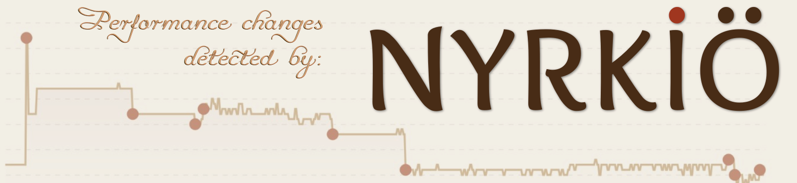

<p align="center">
  
  <h1 align="center">Turso Database</h1>
</p>

<p align="center">
  一个进程内 SQL 数据库，兼容 SQLite，现在还支持 Postgres 前端。
</p>
<p align="center"><a href="./README.md"><b>English</b></a> | <b>简体中文</b></p>

<p align="center">
  <a title="构建状态" target="_blank" href="https://github.com/tursodatabase/turso/actions/workflows/rust.yml"></a>
  <a title="发布" target="_blank" href="https://github.com/tursodatabase/turso/releases"></a>
  <a title="Rust" target="_blank" href="https://crates.io/crates/turso"></a>
  <a title="JavaScript" target="_blank" href="https://www.npmjs.com/package/@tursodatabase/database"></a>
  <a title="Python" target="_blank" href="https://pypi.org/project/pyturso/"></a>
  <a title="Java" target="_blank" href="https://central.sonatype.com/artifact/tech.turso/turso"></a>
  <a title=".NET" target="_blank" href="https://www.nuget.org/packages/Turso.Data.Sqlite.Provider"></a>
  <a title="MIT" target="_blank" href="https://github.com/tursodatabase/turso/blob/main/LICENSE.md"></a>
  <br>
  <a title="GitHub Pull Requests" target="_blank" href="https://github.com/tursodatabase/turso/pulls"></a>
  <a title="GitHub 提交" target="_blank" href="https://github.com/tursodatabase/turso/commits/main"></a>
  <a title="最后提交" target="_blank" href="https://github.com/tursodatabase/turso/commits/main"></a>
</p>
<p align="center">
  <a title="开发者 Discord" target="_blank" href="https://discord.gg/jgjmyYgHwB"></a>
</p>
<p align="center">
  <a title="用户 Discord" target="_blank" href="https://tur.so/discord"></a>
</p>

---

## 关于

Turso 是一个用 Rust 编写的进程内 SQL 数据库，兼容 SQLite，目前已在多个组织的生产环境中运行。

Turso 同时也是一台虚拟机。与 SQLite 一样，它把 SQL 编译成这台机器（即 VDBE）的字节码，然后执行字节码。正是这种设计让一个引擎可以承载多种 SQL 方言：SQLite 是第一个也是主要的前端，而 Postgres 现在也拥有了自己的前端，具备自己的方言和线协议（wire protocol）。未来还会有更多。我们的目标是成为数据库领域的 LLVM——以一个现代、可靠的核心，承载众多编译到其上的前端。

这个核心有多通用？通用到可以在它上面[运行 Doom](https://github.com/tursodatabase/turso-vdbe-doom-example)。

查看 [FAQ](#faq) 了解项目迈向 1.0 的进展。

## 特性与路线图

* **SQLite 兼容性**：兼容 SQL 方言、文件格式和 C API，跟踪 SQLite 3.50.4 版本，详见[兼容性文档](COMPAT.md)
* **`BEGIN CONCURRENT`**：使用多版本并发控制（MVCC）提升写入吞吐量。
* **变更数据捕获（CDC）**：实时跟踪数据库变更。
* **多语言支持**：
  * [Go](bindings/go)
  * [JavaScript](bindings/javascript)
  * [Java](bindings/java)
  * [.NET](bindings/dotnet)
  * [Python](bindings/python)
  * [Rust](bindings/rust)
  * [WebAssembly](bindings/javascript)
* **异步 I/O**：在 Linux 上通过 `io_uring` 支持。
* **跨平台**：支持 Linux、macOS、Windows 和浏览器（通过 WebAssembly）。
* **向量支持**：包括精确搜索和向量操作。
* **改进的模式管理**：包括扩展的 `ALTER` 支持和更快的模式变更。

数据库还具有以下实验性特性：

* **Postgres 兼容性**：兼容 SQL 方言和线协议，详见[兼容性参考](postgres/COMPAT.md)。
* **静态加密**：保护本地数据。
* **增量计算**：使用 DBSP 进行增量视图维护和查询订阅。
* **全文搜索**：由出色的 [tantivy](https://github.com/quickwit-oss/tantivy) 库驱动。
* **多进程 WAL 协调**：通过 `.tshm` sidecar 文件实现跨进程的 WAL 读写。

以下功能在我们的当前路线图上：

* **向量索引**：快速近似向量搜索，类似 [libSQL 向量搜索](https://turso.tech/vector)。

## 快速上手

更多信息请参阅 [Turso 数据库手册](docs/manual.md)。

<details>
<summary>💻 命令行</summary>
<br>
你可以通过以下命令安装最新的 `turso` 发布版：

```shell
curl --proto '=https' --tlsv1.2 -LsSf \
  https://github.com/tursodatabase/turso/releases/latest/download/turso_cli-installer.sh | sh
```

然后启动交互式 shell：

```shell
$ tursodb
```

这将启动 Turso 交互式 shell，你可以在其中执行 SQL 语句：

```console
Turso
Enter ".help" for usage hints.
Connected to a transient in-memory database.
Use ".open FILENAME" to reopen on a persistent database
turso> CREATE TABLE users (id INT, username TEXT);
turso> INSERT INTO users VALUES (1, 'alice');
turso> INSERT INTO users VALUES (2, 'bob');
turso> SELECT * FROM users;
1|alice
2|bob
```

你也可以通过以下方式构建并运行最新的开发版本：

```shell
cargo run
```

如果你喜欢 Docker，我们也考虑到了。只需在仓库根目录运行：

```bash
make docker-cli-build && \
make docker-cli-run
```

</details>

<details>
<summary>🦀 Rust</summary>
<br>

```console
cargo add turso
```

示例用法：

```rust
let db = Builder::new_local("sqlite.db").build().await?;
let conn = db.connect()?;

let res = conn.query("SELECT * FROM users", ()).await?;
```
</details>

<details>
<summary>✨ JavaScript</summary>
<br>

```console
npm i @tursodatabase/database
```

示例用法：

```js
import { connect } from '@tursodatabase/database';

const db = await connect('sqlite.db');
const stmt = db.prepare('SELECT * FROM users');
const users = stmt.all();
console.log(users);
```
</details>

<details>
<summary>🐍 Python</summary>
<br>

```console
uv pip install pyturso
```

示例用法：

```python
import turso

con = turso.connect("sqlite.db")
cur = con.cursor()
res = cur.execute("SELECT * FROM users")
print(res.fetchone())
```
</details>

<details>
<summary>🦫 Go</summary>
<br>

```console
go get turso.tech/database/tursogo
go install turso.tech/database/tursogo
```

示例用法：
```go
import (
    "database/sql"
    _ "turso.tech/database/tursogo"
)

conn, _ = sql.Open("turso", "sqlite.db")
defer conn.Close()

stmt, _ := conn.Prepare("select * from users")
defer stmt.Close()

rows, _ = stmt.Query()
for rows.Next() {
    var id int
    var username string
    rows.Scan(&id, &username)
    fmt.Printf("User: ID: %d, Username: %s\n", id, username)
}
```
</details>


<details>

<summary>️#️⃣ .NET</summary>
<br>

示例用法：
```cs
using Turso;

using var connection = new TursoConnection("Data Source=:memory:");
connection.Open();

connection.ExecuteNonQuery("CREATE TABLE t(a, b)");
var rowsAffected = connection.ExecuteNonQuery("INSERT INTO t(a, b) VALUES (1, 2), (3, 4)");
Console.WriteLine($"RowsAffected: {rowsAffected}");

using var command = connection.CreateCommand();
command.CommandText = "SELECT * FROM t";
using var reader = command.ExecuteReader();
while (reader.Read())
{
    var a = reader.GetInt32(0);
    var b = reader.GetInt32(1);
    Console.WriteLine($"Value1: {a}, Value2: {b}");
}
```
</details>


<details>

<summary>☕️ Java</summary>
<br>

我们已将 Turso 数据库集成到 JDBC。有关如何配合 Java 使用的详细说明，请参阅 [bindings/java 下的 README.md](bindings/java/README.md)。
</details>

<details>
<summary>🤖 MCP 服务器模式</summary>
<br>


Turso CLI 内置了 [Model Context Protocol（MCP）](https://modelcontextprotocol.io/) 服务器，可以让 AI 助手与你的数据库交互。

通过以下命令启动 MCP 服务器：

```shell
tursodb your_database.db --mcp
```

### 配置

将 Turso 添加到你的 MCP 客户端配置中：

```json
{
  "mcpServers": {
    "turso": {
      "command": "/path/to/.turso/tursodb",
      "args": ["/path/to/your/database.db", "--mcp"]
    }
  }
}
```

### 可用工具

MCP 服务器提供九个数据库交互工具：

1. **`open_database`** - 打开一个新数据库
2. **`current_database`** - 描述当前数据库
3. **`list_tables`** - 列出数据库中的所有表
4. **`describe_table`** - 描述指定表的结构
5. **`execute_query`** - 执行只读 SELECT 查询
6. **`insert_data`** - 向表中插入新数据
7. **`update_data`** - 更新表中的现有数据
8. **`delete_data`** - 删除表中的数据
9. **`schema_change`** - 执行模式修改语句（CREATE TABLE、ALTER TABLE、DROP TABLE）

连接后，你可以这样问你的 AI 助手：

- "显示数据库中的所有表"
- "users 表的模式是什么？"
- "找出所有点赞数超过 100 的帖子"
- "插入一个名为 ‘Alice’、邮箱为 ‘alice@example.com’ 的新用户"

### MCP 客户端

<details>
<summary>Claude Code</summary>

如果你在使用 [Claude Code](https://claude.ai/code)，可以通过内置的 MCP 管理命令轻松连接到你的 Turso MCP 服务器：

#### 快速设置

1. **添加 MCP 服务器**到 Claude Code：

   ```bash
   claude mcp add my-database -- tursodb ./path/to/your/database.db --mcp
   ```

2. **重启 Claude Code** 以激活连接

3. **开始查询**——用自然语言向你的数据库提问！

#### 命令解析

```bash
claude mcp add my-database -- tursodb ./path/to/your/database.db --mcp
#              ↑            ↑       ↑                           ↑
#              |            |       |                           |
#              Name         |       Database path               MCP flag
#                          Separator
```

- **`my-database`** - 为你的 MCP 服务器取任意名称
- **`--`** - Claude 选项与你的命令之间的必需分隔符
- **`tursodb`** - Turso 数据库 CLI
- **`./path/to/your/database.db`** - SQLite 数据库文件路径
- **`--mcp`** - 启用 MCP 服务器模式

#### 使用示例

```bash
# For a local project database
cd /your/project
claude mcp add my-project-db -- tursodb ./data/app.db --mcp

# For an absolute path
claude mcp add analytics-db -- tursodb /Users/you/databases/analytics.db --mcp

# For a specific project (local scope)
claude mcp add project-db --local -- tursodb ./database.db --mcp
```

#### 管理 MCP 服务器

```bash
# List all configured MCP servers
claude mcp list

# Get details about a specific server
claude mcp get my-database

# Remove an MCP server
claude mcp remove my-database
```

</details>

<details>
<summary>Claude Desktop</summary>

对于 Claude Desktop，请将配置添加到你的 `claude_desktop_config.json` 文件中：

```json
{
  "mcpServers": {
    "turso": {
      "command": "/path/to/.turso/tursodb",
      "args": ["./path/to/your/database.db", "--mcp"]
    }
  }
}
```

</details>

<details>
<summary>Cursor</summary>

对于 Cursor，请在设置中配置 MCP：

1. 打开 Cursor 设置
2. 进入 Extensions → MCP
3. 添加一个新服务器：
   - **Name**: `turso`
   - **Command**: `/path/to/.turso/tursodb`
   - **Args**: `["./path/to/your/database.db", "--mcp"]`

或者，你也可以直接将其添加到 Cursor 的配置文件中。

</details>

### 直接使用 JSON-RPC

MCP 服务器以单进程运行，通过标准输入/输出处理多个 JSON-RPC 请求。以下是如何直接与它交互：

#### 内存数据库示例

```bash
cat << 'EOF' | tursodb --mcp
{"jsonrpc": "2.0", "id": 1, "method": "initialize", "params": {"protocolVersion": "2024-11-05", "capabilities": {}, "clientInfo": {"name": "client", "version": "1.0"}}}
{"jsonrpc": "2.0", "id": 2, "method": "tools/call", "params": {"name": "schema_change", "arguments": {"query": "CREATE TABLE users (id INTEGER, name TEXT, email TEXT)"}}}
{"jsonrpc": "2.0", "id": 3, "method": "tools/call", "params": {"name": "list_tables", "arguments": {}}}
{"jsonrpc": "2.0", "id": 4, "method": "tools/call", "params": {"name": "insert_data", "arguments": {"query": "INSERT INTO users VALUES (1, 'Alice', 'alice@example.com')"}}}
{"jsonrpc": "2.0", "id": 5, "method": "tools/call", "params": {"name": "execute_query", "arguments": {"query": "SELECT * FROM users"}}}
EOF
```

#### 已有数据库示例

```bash
# Working with an existing database file
cat << 'EOF' | tursodb mydb.db --mcp
{"jsonrpc": "2.0", "id": 1, "method": "initialize", "params": {"protocolVersion": "2024-11-05", "capabilities": {}, "clientInfo": {"name": "client", "version": "1.0"}}}
{"jsonrpc": "2.0", "id": 2, "method": "tools/call", "params": {"name": "list_tables", "arguments": {}}}
EOF
```

</details>

## 贡献

我们非常欢迎你为 Turso 数据库做贡献！请查阅[贡献指南]开始。

## FAQ

### Turso 数据库可以用于生产环境了吗？

是的——Turso 目前已在多个组织的生产应用中提供动力，包括 [Turso Cloud](https://turso.tech/signup)、[Kin AI 助手](https://mykin.ai/) 和 [Spice.ai](https://github.com/spiceai/spiceai)。可靠性是我们的首要任务：Turso 经过一系列工具的广泛测试，包括原生的确定性模拟测试（Deterministic Simulation Testing）套件和 [Antithesis](https://antithesis.com)。

话虽如此，我们尚未达到 1.0。项目仍在积极开发中，部分功能被明确标记为实验性。我们的目标是达到 SQLite 级别的可靠性——它是世界上测试最严格的软件之一——在宣布 1.0 之前，我们建议你像对待任何数据库一样保持严谨：做好独立备份。

### Turso 数据库与 SQLite 的兼容性如何？

Turso 在 SQL 方言、文件格式和 C API 层面与 SQLite 兼容，现有的 SQLite 数据库文件可以直接使用。我们尚未达到 100%，因此仍可能存在一些差异——[COMPAT.md](COMPAT.md) 会跟踪详情——但差距正在迅速缩小，完全兼容是 1.0 的要求。

### Turso 是 SQLite 数据库还是 Postgres 数据库？

它是一个引擎，拥有多个 SQL 前端。SQLite 是最初的主要前端，有自己的方言、文件格式和 C API；如果你使用的就是它，那么对你没有任何变化。Postgres 是一个较新且仍处于实验阶段的前端，使用 Postgres 方言和线协议。它们在 SQL 层面之下共享一切：存储、并发、查询编译器和虚拟机。Postgres 前端是纯附加的——只做新增，不会改变既有行为。

### 你们说的"数据库界的 LLVM"是什么意思？

与 SQLite 一样，Turso 将查询编译成一台名为 VDBE 的虚拟机的字节码并执行。SQL 只是编译到它的一种语言。我们的目标是让这台虚拟机成为一个通用目标：以一个现代、经过严格测试的核心，承载众多数据库前端——SQLite、Postgres，以及未来更多的前端。LLVM 为编译器做到了这一点：稳定的中间表示让众多语言共享同一个后端，我们认为数据库也应该如此。如果你想要证据，这些字节码通用到可以在上面[运行 Doom](https://github.com/tursodatabase/turso-vdbe-doom-example)。

### Turso 数据库与 Turso 的 libSQL 有什么区别？

Turso 数据库是一个用 Rust 构建 SQLite 下一代形态的项目，高度注重开放贡献，并具备原生异步支持、向量搜索等特性。libSQL 项目也是为了向类似方向演进 SQLite，但采用的是分叉而非重写的方式。

用 Rust 重写 SQLite 最初只是一个不起眼的实验，但因其巨大的成功，它取代 libSQL 成为我们的既定方向。两者如今都在生产环境中运行：libSQL 经过更长时间的战斗检验，而 Turso 数据库是我们开发投入的重点，正在快速演进。更多详情见[此处](https://turso.tech/blog/we-will-rewrite-sqlite-and-we-are-going-all-in)。

## 论文发表

* Pekka Enberg, Sasu Tarkoma, Jon Crowcroft Ashwin Rao (2024). Serverless Runtime / Database Co-Design With Asynchronous I/O. In _EdgeSys ‘24_. [[PDF]](https://penberg.org/papers/penberg-edgesys24.pdf)
* Pekka Enberg, Sasu Tarkoma, and Ashwin Rao (2023). Towards Database and Serverless Runtime Co-Design. In _CoNEXT-SW ’23_. [[PDF](https://penberg.org/papers/penberg-conext-sw-23.pdf)] [[Slides](https://penberg.org/papers/penberg-conext-sw-23-slides.pdf)]
* Alperen Keles, Ethan Chou, Harrison Goldstein, Leonidas Lampropoulos (2026). DIRT: Database-Integrated Random Testing. In _DBTest '26_. [[PDF]](https://arxiv.org/pdf/2604.16373)

## 许可证

本项目基于 [MIT 许可证] 发布。

### 贡献

除非你另有明确声明，否则你为纳入 Turso 数据库而有意提交的任何贡献，均应以 MIT 许可证授权，无任何附加条款或条件。

[contribution guide]: CONTRIBUTING.md
[MIT license]: LICENSE.md

## 合作伙伴

感谢 Turso 的所有合作伙伴！

<a href="https://antithesis.com/"></a>

<a href="https://blacksmith.sh"></a>

<a href="https://nyrkio.com/"></a>

## 贡献者

感谢 Turso 数据库的所有贡献者！

<a href="https://github.com/tursodatabase/turso/graphs/contributors">
  
</a>
